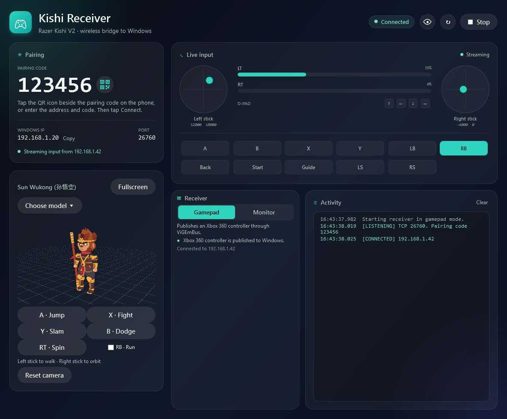

# Kishi Wi-Fi

Use a Razer Kishi V2 attached to an Android phone as a wireless gamepad for Windows, Linux, macOS, or a second Android device. The phone reads the Kishi over USB-C and sends buttons, sticks, and triggers over Wi-Fi. The Rust desktop receiver creates an Xbox 360 controller on Windows and a virtual gamepad on Linux. Native SwiftUI and WPF receivers provide the macOS and Windows apps.

The phone and PC must be on the same local network. The PC can use Ethernet. Use a trusted LAN because the pairing code and controller reports travel over unencrypted TCP.

## Start the Windows receiver



*Example session with sample pairing details and controller input.*

Install Rust with Cargo and the Windows MSVC build tools. Install the [ViGEmBus driver](https://github.com/nefarius/ViGEmBus/releases/tag/v1.22.0) on the PC that will run the game.

Build the receiver:

```powershell
cargo build --locked --release --manifest-path .\server\Cargo.toml
```

Double-click **Launch-Receiver.vbs** in the **server** folder to start the receiver minimized on the taskbar with PowerShell hidden. Click its taskbar icon to open the dashboard.

The WPF dashboard matches the macOS receiver: pairing code, Windows LAN address, connection status, live sticks, triggers, D-pad, buttons, activity log, and Gamepad/Monitor modes. It starts the receiver automatically and hides its console window.

If PowerShell blocks the script, run it with `powershell -ExecutionPolicy Bypass -File .\server\Launch-Receiver.ps1`. Allow the receiver on your private network if Windows Firewall prompts. Keep the dashboard open while playing.

Click **Monitor** or **Gamepad** in the Receiver panel to switch modes. Changing modes while running restarts the listener. Reconnect your phone with the new pairing code.

Use **Monitor** mode to verify pairing and live input before ViGEmBus is installed; Gamepad mode publishes the Xbox 360 controller. The Rust command-line receiver is still available with `cargo run --locked --release --manifest-path .\server\Cargo.toml`.

### Windows character preview

Use the eye icon in the dashboard header to hide or show the 3D model. The receiver remembers your choice.

Open **Choose model** in the dashboard or click the character name in fullscreen. The receiver scans [server/assets](server/assets) each time you open the menu. You can try the controls before pairing by dragging the on-screen sticks and clicking the action buttons.

| Character | Weapon and attack |
| --- | --- |
| Sun Wukong (孙悟空) | Extends his staff through a sweeping swing. |
| Zhu Bajie (猪八戒) | Sweeps with his nine-tooth rake. |
| Bull Demon King (牛魔王) | Brings his poleaxe down into a two-handed forward push. |
| Sha Seng (沙僧) | Pushes his crescent halberd forward with both hands. |
| Tang Seng (唐僧) | Leads his two-handed push with the ringed head of his pilgrim staff. |
| Princess Iron Fan (铁扇公主) | Enlarges her fan during the attack and returns it to its original size on recovery. |

| Action | Controller | Dashboard or keyboard |
| --- | --- | --- |
| Walk / run | Left stick / hold **RB** while moving | Drag the left stick / toggle **Run** |
| Orbit and tilt the camera | Right stick | Drag the right stick. **Reset camera** restores the default view. |
| Jump with a forward somersault | **A** | **Jump** or **J** |
| Attack | **X** | **Fight** or **K**. Tap again during a swing to chain a follow-up, or attack during a jump. |
| Slam with a ground shockwave | **Y** | **Slam** or **I** |
| Dodge | **B** | **Dodge** or **L**. Use the left stick to choose a direction, or center it to backstep. |
| 360° weapon swing | Squeeze **RT / R2** while grounded | **Spin** or **U**. Release and squeeze the trigger again to repeat. |
| Fullscreen | | **Fullscreen** or **F11** to enter. **Esc** or **F11** to return. |

**Add a character.** Place a compatible `.glb` in `server/assets` and reopen the menu. The loader maps common humanoid joint names, including Mixamo-style names, and detects rigid equipment beneath either hand. An unarmed humanoid receives a preview staff.

Use a bundled GLB as the export reference. The loader expects one humanoid skin with translation-only bind joints, indexed triangles in bind space, tightly packed float positions, normals and weights, four byte joint indices per vertex, and 16-bit triangle indices.

## Start the Linux receiver

The receiver needs read/write access to `/dev/uinput`. If the device is missing, load the kernel module with `sudo modprobe uinput`. On a system with ACL tools, grant your account access to the current device node with `sudo setfacl -m "u:$(id -un):rw" /dev/uinput`. [Linux uinput documentation](https://docs.kernel.org/input/uinput.html)

Extract the Linux x86-64 archive and run `./kishi-receiver`. To build and run from source with Rust and Cargo, use the following command from the repository root.

```sh
cargo run --locked --release --manifest-path server/Cargo.toml
```

Find your active LAN IPv4 address with `ip -br -4 addr`. Enter it and the six-digit code printed in the terminal on the Kishi phone, then tap **Connect**. To verify game input, open `evtest`, select **Kishi Wi-Fi Gamepad**, and move a stick or press a button.

## Start the macOS receiver

The macOS app is a native SwiftUI receiver. It shows the Mac’s LAN address, the six-digit pairing code, connection status, live sticks, triggers, D-pad, buttons, and an activity log.

The header’s eye icon switches between live input and the character preview. The preview displays the six bundled GLBs. The preview uses the same controller bindings as the Windows character preview, including RT for the 360° swing. It works in both Monitor and Gamepad modes. For extra models, copy compatible humanoid GLBs to `~/Library/Application Support/Kishi Receiver/Characters/` and reopen the model picker.

Build it with Xcode Command Line Tools and Node.js 18 or newer with npm, then open it:

```sh
./macos/build.sh
open "macos/build/Kishi Receiver.app"
```

For a universal build on Apple Silicon, use `ARCHS=universal ./macos/build.sh`.

Enter the address shown in the app (for example `192.168.0.38`) and the pairing code on the phone, then tap **Connect**. Allow incoming connections and local-network access if macOS prompts.

**Gamepad mode.** The app publishes **Kishi Wi-Fi Gamepad** through IOKit. This requires signing with a macOS provisioning profile for an explicit App ID authorized for Apple’s virtual HID entitlement. Build with your identity and profile:

```sh
SIGNING_IDENTITY="Apple Development: Your Name (TEAMID)" \
PROVISIONING_PROFILE="/path/to/profile.provisionprofile" \
./macos/build.sh
open "macos/build/Kishi Receiver.app"
```

To re-sign an existing build, use `sh macos/sign-macos.sh "macos/build/Kishi Receiver.app" "/path/to/profile.provisionprofile" "Apple Development: Your Name (TEAMID)"`. [Apple virtual HID entitlement](https://developer.apple.com/documentation/bundleresources/entitlements/com.apple.developer.hid.virtual.device)

**Monitor mode.** Without the entitlement the app starts in **Monitor** and still pairs and displays live input, but games receive nothing. Changing modes while running restarts the listener and generates a new pairing code. Run `hidutil list` to confirm that **Kishi Wi-Fi Gamepad** appears in gamepad mode, then test it in a HID-controller-compatible game.

The original Rust command-line receiver remains available in `server/`. It supports `--monitor` without signing, and `server/sign-macos.sh` can sign the CLI executable for gamepad mode.

## Build and install the Android app

The app runs on Android 6.0 (API 23) or newer. To build it on Windows, install a JDK such as JDK 17 and put `java`, `javac`, `jar`, and `keytool` on your PATH. Install Android SDK Platform 35 and Build Tools 35.0.0.

```powershell
.\android\build.ps1
```

The script defaults to `D:\Android\Sdk`. For another SDK location, pass its path with `-Sdk`. The first build downloads the checksum-verified ZXing scanner library from Maven Central. It compiles the app, signs it with a local debug key, and verifies the APK.

Copy **`android\build\Kishi-WiFi.apk`** to the phone and tap it to install. If prompted, allow installation from the app opening the file. Keep `android\build\debug.jks` locally so future builds can update the installed app and preserve its profiles.

## Pair and test

**Pair with a QR code.** On the Windows, macOS, or Android receiver, click the QR icon beside the six-digit code. On the sending phone, tap the QR icon beside **Pairing code**, allow camera access, and point it at the receiver screen. The app fills in the receiver address and pairing code. Tap **Connect** below the pairing fields to pair. You can also type both fields manually. After restarting the receiver or switching modes, scan its new code.

### Receive on a Google Pixel 7 Pro

Install the APK on the Kishi phone as usual. On the receiving Pixel, enable Developer options and authorize USB debugging or pair wireless ADB. From PowerShell run the setup script with the Pixel connected:

```powershell
.\android\Enable-PixelReceiver.ps1                       # USB
.\android\Enable-PixelReceiver.ps1 -Serial 'IP:PORT'     # paired wireless ADB connection
```

Run one of those commands. It installs the APK and starts the shell helper that creates an Android gamepad. Repeat after a Pixel reboot. In **Receiver mode**, tap **Start receiver**. On the Kishi phone, enter the Pixel’s Wi-Fi address and the six-digit code displayed in the receiver screen. Once paired, open a controller-compatible game on the Pixel and keep the sender app open on the Kishi phone. The Pixel receives in the background and can be disconnected from ADB. To end the session, open **Receiver mode → Stop receiver**. Starting the receiver again generates a new gamepad pairing code.

### Receive on Windows

1. Attach the Kishi and open **Kishi Wi-Fi**. Move a stick and check that the landscape input monitor responds before pairing.
2. Enter the PC’s IPv4 address and the six-digit code from the receiver window, then tap **Connect**. Keep the app in the foreground.
3. On Windows, press **Win + R**, enter `joy.cpl`, select the Xbox 360 controller, and open **Properties → Test**. Press a button or move a stick to verify that Windows receives it.

**Saved receivers.** Tap **Profiles → Save current address** and give the PC a name. The app restores the last address on launch. To switch PCs, disconnect and select another profile. Each receiver launch generates a fresh pairing code.

**Automatic reconnect.** After pairing, the app retries a dropped connection after 1, 2, 4, then 8 seconds between attempts. Tap **Disconnect** to cancel. If the PC receiver restarts, enter its new pairing code.

**Receiver RTT.** About once per second, the phone times an input report that requests an acknowledgement. In gamepad mode the receiver acknowledges it after applying the report to the virtual controller. The displayed milliseconds cover that round trip. Game rendering and display latency are outside the measurement.

## Troubleshooting

| Symptom | What to check |
| --- | --- |
| The receiver reports `Cannot open ViGEmBus` | Install the driver on Windows and restart the receiver. |
| The phone cannot pair | Check the current code, the PC’s LAN address, and private-network firewall access for TCP port `26760`. Guest Wi-Fi may isolate devices. |
| The phone connects but the game sees no input | Use gamepad mode. On macOS, the app falls back to Monitor when unsigned; sign it with the virtual HID entitlement. Check `joy.cpl` on Windows, `evtest` on Linux, or `hidutil list` on macOS. |
| Input stops when switching apps | Return to Kishi Wi-Fi. The app releases the connection while paused and attempts to reconnect when the same activity resumes. |

To inspect incoming controller states in the terminal, stop the receiver with **Ctrl+C** and start monitor mode:

```powershell
cargo run --locked --release --manifest-path .\server\Cargo.toml -- --monitor
```

Pair using the newly printed code. This mode logs state changes and works without ViGEmBus. Restart in normal mode to play.
